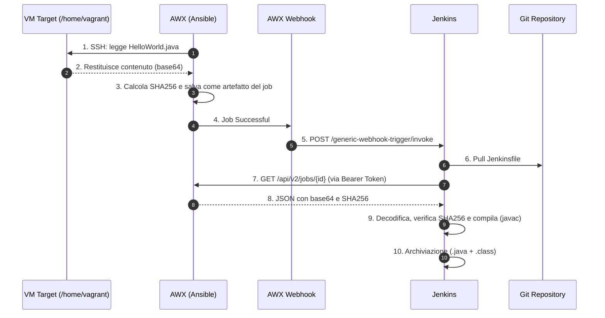

# Progetto AWX + Jenkins

Questo progetto implementa una pipeline con **AWX** per l'orchestrazione sull'infrastruttura e **Jenkins** per la gestione della pipeline di compilazione ed archiviazione del codice Java.

L'intero flusso preleva un file sorgente Java (`HelloWorld.java`) da una VM , garantisce l'integrità tramite SHA256 e ne esegue la compilazione.

---

## Schema del Flusso Architetturale

---

## Componenti del Progetto

Il sistema si compone di due parti principali:
1. **Playbook Ansible:** Si connette alla macchina virtuale target, legge il codice sorgente, calcola lo SHA256 e pubblica i dati.
2. **Jenkinsfile:** Riceve il trigger, interroga le API REST di AWX per scaricare il codice in Base64, ne valida l'integrità e compila l'applicazione Java.

---

### 1. Playbook Ansible (AWX)

Il playbook esegue le seguenti operazioni sulla VM target:
* **Verifica esistenza:** Controlla che il file `/home/vagrant/HelloWorld.java` esista effettivamente.
* Legge il contenuto del file e lo codifica in formato Base64.
* Calcola l'SHA256 della sorgente.
* **Pubblicazione Statistiche:** Rende disponibili i metadati come artefatti del job nelle API di AWX.

---

### 2. Jenkinsfile (Declarative Pipeline)

La pipeline gestisce il trigger webhook in ingresso, effettua il fetch dei dati dalle API di AWX tramite autenticazione, ricostruisce il file sorgente, verifica l'integrità e procede con la compilazione Java e l'archiviazione dei risultati.

## Prerequisiti

* **VM Target:** Accessibile via SSH da AWX, contenente il file `/home/vagrant/HelloWorld.java`.
* **Ansible AWX:** Configurato con inventario e credenziali SSH per raggiungere la VM.
* **Jenkins:** Deve avere installati `curl`, `jq`, `coreutils` e un **JDK** (`javac`) per la compilazione.